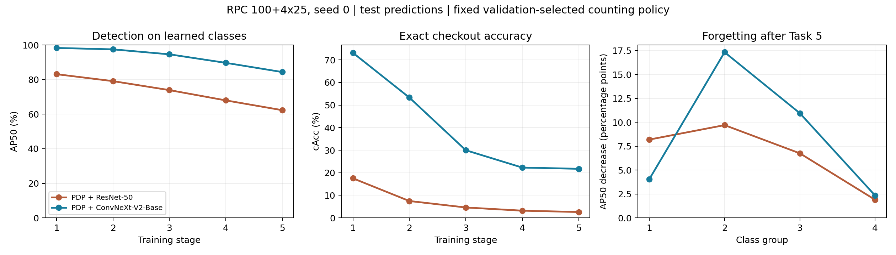

# Báo cáo thực nghiệm PDP trên RPC: ResNet-50 và ConvNeXt-V2-Base — 20/10/2026

Campaign: `data/training/vast4090-seed0-640-v1/baseline`. Kết luận dựa trên artifacts và tính lại từ predictions, không dùng trạng thái training trong tài liệu ngày 13/10.

**Cả EXP-B1 (ResNet-50) và EXP-B2 (ConvNeXt-V2-Base) đã hoàn tất 5 task.** `summary.json` ghi COMPLETED lúc 19:28:27 ngày 15/10/2026 UTC+7. ConvNeXt có chất lượng detection/counting cao hơn trên cùng split, nhưng không có forgetting trung bình thấp hơn.

## Phạm vi kiểm chứng

- Tạo Conda `pdp`, Python 3.10.22 từ conda-forge; kênh defaults bị chặn bởi điều khoản chưa chấp nhận. Cài Torch 2.2.2+cu121, torchvision 0.17.2+cu121, requirements và package editable. Đặt PYTHONNOUSERSITE=1, USE_TF=0; đăng ký kernel `pdp`.
- 64 pins requirements khớp; pip check và imports chính đạt. RTX 3060 hiện chưa dùng được CUDA: nvidia-smi không kết nối driver. Evaluation thực hiện trên CPU, chưa nghiệm thu native CUDA kernel của máy này.
- 63 tests của cl_metrics/eval_cl/counting/eval_count/count_calibration/predictions đạt, không failures/errors/skips.
- 24 input hashes của plan khớp dữ liệu local. Cả 10 final checkpoint hashes khớp summary và calibration policy; 10 validation prediction hashes khớp policy. Detection từng stage khớp snapshot tương ứng.
- Tính lại counting overall/easy/medium/hard của toàn bộ 10 stage từ NPZ: khớp số lưu với tolerance 1e-9 relative / 1e-10 absolute.
- Tính lại grid chọn threshold **trên validation** cho Task 5 của hai model: khớp policy; NMS IoU 0,45, threshold B1/B2 = 0,42/0,35. Không tối ưu trên test, oracle tắt.
- Tính lại final M1 mAP@C/P/A và hàng accuracy matrix Task 5 từ raw predictions: khớp. Không chạy lại inference ảnh hay toàn bộ AP của các stage trước.
- Đọc cả hai final checkpoint bằng Torch trên CPU: `task_id=5`, mọi tensor hữu hạn. Có 224 prototype slots, 200 prototype khác zero; 24 slot còn lại là dự phòng.

Bằng chứng và script: [folder kiểm tra](../../data/training/validation/final_metrics_review_20261020/), gồm `environment.json`, `regression.xml`, `recomputed_metrics.json`, `final_checkpoint_audit.json`, `recheck_metrics.py`. Chạy lại script từ repo root bằng interpreter Conda pdp.

## Mục tiêu, thiết kế và dữ liệu

Thí nghiệm đánh giá việc thay backbone trong pipeline PDP đã triển khai cho bài toán phát hiện/đếm SKU trên khay checkout. Hai câu hỏi chính là chất lượng trên toàn bộ 200 SKU sau học liên tục và khả năng giữ kiến thức các nhóm SKU đã học. Đây là so sánh hai cấu hình backbone/pretraining trong cùng pipeline, không phải tái lập trực tiếp benchmark COCO của paper.

| Thành phần | Cấu hình đã chạy |
|---|---|
| Dữ liệu | RPC real-only native v1; 22.494 train / 1.503 val / 6.003 test |
| Protocol | 100 + 25 + 25 + 25 + 25 SKU; seed 0 |
| EXP-B1 | PDP + ResNet-50; detector pretrained SenseTime Deformable DETR |
| EXP-B2 | PDP + `convnextv2_base.fcmae_ft_in22k_in1k`; backbone pretrained timm, selective detector transfer |
| Kích thước / batch | 640px; physical/effective 8/8; accumulation 1; 8 workers |
| Budget | 16 epochs/task; một GPU/experiment, B2 trước B1 |
| Số học / optimizer | FP32 + TF32; learning rates 1e-4 và 1e-5; weight decay 1e-4 |
| Freeze | `backbone,encoder,decoder`; nhóm `class_embed,prompts` dùng cấu hình optimizer prompt |
| Prompt/loss | 100 shared prompts, prompt length 10; λDDL=0,15, λQ=0,1; PPG |
| Prototype | Mean prototype; không bật K=3/LoRA/FSA/freeze shared bổ sung |
| Đánh giá | Raw predictions cho detection; top-1/query + class-agnostic NMS 0,45 cho counting |
| Calibration | Grid 0,10–0,90 bước 0,01 trên val; tối đa hóa cAcc, hòa chọn threshold nhỏ nhất |

Split ảnh thật đã khóa; dữ liệu synthetic đã xử lý riêng không được đưa vào baseline này. Các file train_task có nhãn lớp hiện tại. Số 22.494 là số ảnh train của release, không phải tổng số lượt ảnh qua năm task: ảnh nhiều SKU có thể xuất hiện trong nhiều task với bộ nhãn khác nhau.

Nguồn cấu hình: `baseline/plan.json`, `EXP-B1|EXP-B2/resolved_cli.json`, `task_*/run_info.json`, `task_*/runtime.json`. Số liệu báo cáo sử dụng stage cuối đã hoàn tất, không chọn checkpoint theo test. Chưa kiểm chứng rằng budget 16 epochs là điểm hội tụ tối ưu.

## Định nghĩa và cách đọc metrics

- **AP50**: average precision tại IoU bbox 0,50; **AP[.50:.95]**: trung bình qua 10 mức IoU 0,50–0,95; **AP75**: IoU 0,75. AP dùng xếp hạng confidence, không áp threshold counting.
- **mAP@C/P/A**: AP trên lớp mới / các lớp trước / tất cả lớp đã học. M1 giới hạn nhóm lớp và tập ảnh có ít nhất một GT của nhóm đó; C/P vì vậy không nên lấy trung bình thủ công để suy ra A.
- **M2**: protocol store của repo loại predictions chồng lên GT lớp chưa học trước khi tính AP. Sau Task 5 đã học đủ 200 SKU, M1@A và M2 overall bằng nhau; các stage đầu có thể khác.
- **cAcc** = số ảnh có toàn bộ vector đếm SKU chính xác / số ảnh đánh giá.
- **ACD** = tổng |prediction count − GT count| qua ảnh và lớp / số ảnh. Nhầm SKU có thể tạo lỗi ở cả lớp dự đoán và lớp thật.
- **mCCD** = trung bình theo lớp của tổng sai lệch đếm tuyệt đối / tổng GT lớp đó; **mCIoU** = trung bình theo lớp của tổng min(pred,GT) / tổng max(pred,GT). Các lớp không có GT trong tập đánh giá được bỏ khỏi hai trung bình này.
- **mCCS** = trung bình theo lớp của tổng pred / tổng GT. Giá trị 1 chỉ nói tổng đếm cân bằng, không bảo đảm từng ảnh đúng, cũng không phải recall.
- **Forgetting** = trung bình nhóm task cũ của (AP50 tốt nhất trước stage cuối − AP50 stage cuối). Trong báo cáo dùng điểm phần trăm; giá trị thấp hơn tốt hơn.

Các tỉ lệ lưu trong JSON ở [0,1]; bảng AP/cAcc dùng %. Chênh lệch hai tỉ lệ tính bằng **điểm phần trăm**, không gọi là phần trăm tăng tương đối. Độ khó easy/medium/hard lấy từ metadata release.

## Kết quả cuối trên test

Test có 6.003 ảnh, đủ 200 SKU. AP và các tỉ lệ bên dưới biểu diễn bằng phần trăm; Δ là ConvNeXt trừ ResNet, đơn vị điểm phần trăm. ACD giữ đơn vị lỗi đếm tuyệt đối trung bình mỗi ảnh.

| Metric | ResNet-50 | ConvNeXt-V2-Base | Δ |
|---|---:|---:|---:|
| mAP@A AP50 ↑ | 62,33 | 84,40 | +22,07 |
| mAP@A AP[.50:.95] ↑ | 51,55 | 71,37 | +19,81 |
| mAP@A AP75 ↑ | 59,90 | 81,91 | +22,01 |
| mAP@P AP50, 175 lớp cũ ↑ | 64,79 | 85,93 | +21,14 |
| mAP@C AP50, 25 lớp mới ↑ | 47,59 | 74,70 | +27,11 |
| cAcc ↑ | 2,58 | 21,74 | +19,16 |
| ACD ↓ | 8,8311 | 3,9187 | −4,9124 |
| mCCD ↓ | 74,30 | 31,72 | −42,59 |
| mCIoU ↑ | 45,28 | 74,65 | +29,37 |
| Forgetting AP50 trung bình ↓ | 6,63 | 8,67 | +2,03 |

cAcc yêu cầu đúng toàn bộ vector số lượng theo SKU trong một ảnh: B1 đúng 155/6.003 ảnh, B2 đúng 1.305/6.003. ConvNeXt giảm ACD khoảng 55,63%, nhưng cAcc 21,74% vẫn còn thấp cho checkout tự động. mCCD không phải tỉ lệ ảnh sai; đây là trung bình theo lớp của tổng sai lệch tuyệt đối chia tổng GT.

Nguồn: [B1 detection](../../data/training/vast4090-seed0-640-v1/baseline/EXP-B1/metrics_cl_test.json), [B2 detection](../../data/training/vast4090-seed0-640-v1/baseline/EXP-B2/metrics_cl_test.json), [B1 counting](../../data/training/vast4090-seed0-640-v1/baseline/EXP-B1/metrics_count_test.json), [B2 counting](../../data/training/vast4090-seed0-640-v1/baseline/EXP-B2/metrics_count_test.json).

## Diễn biến theo task

| Task / số SKU đã học | B1 AP50 | B2 AP50 | B1 cAcc | B2 cAcc |
|---|---:|---:|---:|---:|
| 1 / 100 | 83,16 | 98,35 | 17,52 | 73,16 |
| 2 / 125 | 79,14 | 97,54 | 7,46 | 53,32 |
| 3 / 150 | 73,94 | 94,66 | 4,60 | 29,97 |
| 4 / 175 | 67,99 | 89,72 | 3,18 | 22,29 |
| 5 / 200 | 62,33 | 84,40 | 2,58 | 21,74 |



AP50 tổng giảm qua stage không đồng nghĩa toàn bộ độ giảm là forgetting: tập lớp đánh giá tăng thêm và lớp mới có độ khó khác nhau. cAcc các stage đầu cũng chỉ đánh giá số lượng trên tập lớp đã học.

Forgetting được tính từ accuracy matrix: với mỗi nhóm 1–4, lấy AP50 tốt nhất trước stage 5 trừ AP50 cuối, rồi trung bình đều bốn nhóm. B1/B2 lần lượt:

| Nhóm lớp | B1 forgetting | B2 forgetting |
|---|---:|---:|
| Task 1 | 8,19 | 4,05 |
| Task 2 | 9,70 | 17,33 |
| Task 3 | 6,75 | 10,95 |
| Task 4 | 1,89 | 2,34 |

ConvNeXt giữ nhóm Task 1 tốt hơn nhưng mất nhiều hơn ở Task 2–3 so với đỉnh của chính nó. Dù vậy AP50 cuối của ConvNeXt vẫn cao hơn B1 ở mọi nhóm. Không kết luận ConvNeXt chống quên tốt hơn chỉ từ mAP@P cao hơn. `avg_last_row` là trung bình đều nhóm task, không phải mAP@A trên 200 lớp vì Task 1 có 100 lớp còn mỗi task sau chỉ có 25.

## Counting theo độ khó và nhóm lớp

| Độ khó | Số ảnh | B1 cAcc | B2 cAcc | B1 ACD | B2 ACD |
|---|---:|---:|---:|---:|---:|
| Easy | 2.008 | 6,42 | 35,46 | 5,4109 | 2,3715 |
| Medium | 1.969 | 1,32 | 21,28 | 8,8217 | 3,6907 |
| Hard | 2.026 | 0,00 | 8,59 | 12,2300 | 5,6737 |

Ở Task 5, mCCS của lớp mới là 0,0927 / 0,4318 (B1/B2), lớp cũ là 1,0624 / 1,0913. mCCS là trung bình theo SKU của tổng dự đoán/tổng GT, **không phải recall**. Điều này cho thấy đếm thiếu rõ rệt ở nhóm mới trong khi tổng đếm nhóm cũ hơi dư; chưa đủ để tách nguyên nhân giữa classifier, confidence calibration, duplicate boxes và NMS. Không thay policy dựa trên test; phân tích thêm cần thực hiện trên validation trước.

Validation/test AP cuối gần nhau: B1 52,22/51,55%; B2 72,15/71,37%. Chênh lệch nhỏ không tự chứng minh hội tụ hay loại trừ mọi vấn đề dữ liệu.

## Đối chiếu paper gốc

Đã đọc PDF CVPR trong repo, mục 5.1 và Bảng 1, đối chiếu [paper chính thức](https://openaccess.thecvf.com/content/CVPR2026/html/Zhang_Beyond_Prompt_Degradation_Prototype-guided_Dual-pool_Prompting_for_Incremental_Object_Detection_CVPR_2026_paper.html) và [bản tác giả trên arXiv](https://arxiv.org/html/2603.02286v1).

Paper dùng **AP50** cho mAP@P/C/A trong bảng multi-step COCO. Không so 59,4 của paper với cột AP[.50:.95] của repo.

| Thực nghiệm, stage cuối | mAP@P AP50 | mAP@C AP50 | mAP@A AP50 |
|---|---:|---:|---:|
| PDP paper, COCO, 4 task | 61,3 | 55,8 | 59,4 |
| Repo B1, RPC, 5 task | 64,79 | 47,59 | 62,33 |
| Repo B2, RPC, 5 task | 85,93 | 74,70 | 84,40 |

Đây là đối chiếu mô tả, không phải bảng xếp hạng cùng benchmark: khác dataset, số lớp, số task, split, pretrained và cấu hình triển khai. Không thể kết luận repo vượt paper từ 84,40 > 59,4. Paper không báo cáo checkout cAcc/ACD/mCCD/mCIoU để đối chiếu trực tiếp. Các chỉ số đếm là đánh giá bổ sung cho bài toán RPC.

## Tính công bằng, provenance và điểm cần lưu ý

- Cùng mapping/split/hash, seed 0, 640px, physical/effective batch 8/8, 16 epochs/task, FP32+TF32; cùng PPG, DDL và freeze backbone/encoder/decoder. Runtime xác nhận đúng tên hai backbone. Args Task 5 chỉ khác backbone, pretrained backbone file và output directory.
- Số optimizer steps mỗi task bằng nhau giữa hai model: 43.504 / 25.072 / 24.272 / 23.712 / 26.768.
- So sánh đo hiệu quả hai cấu hình backbone kèm pretrained tương ứng; không tách riêng tác động kiến trúc khỏi nguồn pretraining và adapter/transfer. Một seed chưa đủ kết luận độ ổn định thống kê.
- B2 có lịch sử train/resume qua 4090, L4, 4080 SUPER; B1 chạy trên 4080 SUPER. Không dùng tổng thời gian phiên cuối của B2 để kết luận tốc độ backbone.
- Run provenance ghi commit 5c288e6 và dirty working tree; danh sách diff được lưu chỉ gồm docs/notebook và .gitignore. Code pdp/autocheckout/tools/configs hiện tại không đổi so với commit đó. Không khẳng định snapshot docs là code checkout sạch.
- `EXP-B2/task_5/progress.json` vẫn ghi RUNNING ở step 25.213, trong khi run_info ghi train kết thúc 26.768, có final checkpoint, predictions, stage receipt và summary COMPLETED. File progress là trạng thái cũ/không đồng bộ; chưa xác định vì sao. Đã giữ nguyên file gốc.
- Đây là split nghiên cứu RPC; không phải official RPC test2019 benchmark. Tài liệu release ghi có thể dùng lại cùng ảnh ở nhiều task với nhãn lớp hiện tại; báo cáo replay-free cần nêu rõ quy ước này. Không làm lại audit nội dung ảnh/train-test leakage trong lượt kiểm tra metrics này.

Kết luận phù hợp cho báo cáo: trên split RPC 100+4×25, seed 0, ConvNeXt-V2-Base nâng final AP50 22,07 điểm và cAcc 19,16 điểm so với ResNet-50, nhưng forgetting trung bình tăng 2,03 điểm. Chất lượng đếm trên ảnh hard và lớp mới vẫn là hạn chế chính. Kết quả là chuyển ứng dụng PDP sang RPC, chưa phải tái lập benchmark COCO/VOC của paper.


## Phụ lục A — detection đầy đủ theo stage

AP dưới đây là M1; đơn vị %. AP@P ở Task 1 không áp dụng.

### EXP-B1: ResNet-50

| Task | Val AP50@A | Test AP50@C | Test AP50@P | Test AP50@A | Test AP@A [.50:.95] | Test AP75@A |
|---|---:|---:|---:|---:|---:|---:|
| 1 | 83,01 | 83,16 | — | 83,16 | 70,07 | 80,25 |
| 2 | 79,53 | 65,72 | 83,58 | 79,14 | 66,50 | 76,33 |
| 3 | 74,52 | 61,08 | 77,35 | 73,94 | 61,82 | 71,16 |
| 4 | 69,04 | 54,43 | 70,78 | 67,99 | 56,61 | 65,42 |
| 5 | 63,47 | 47,59 | 64,79 | 62,33 | 51,55 | 59,90 |

Ma trận AP50: hàng = sau khi học stage, cột = nhóm SKU được giới thiệu ở task.

| Stage | Nhóm 1 (100 SKU) | Nhóm 2 | Nhóm 3 | Nhóm 4 | Nhóm 5 |
|---|---:|---:|---:|---:|---:|
| 1 | 83,16 | — | — | — | — |
| 2 | 83,58 | 65,72 | — | — | — |
| 3 | 81,73 | 63,99 | 61,08 | — | — |
| 4 | 78,48 | 59,88 | 58,31 | 54,43 | — |
| 5 | 75,39 | 56,01 | 54,32 | 52,53 | 47,59 |

### EXP-B2: ConvNeXt-V2-Base

| Task | Val AP50@A | Test AP50@C | Test AP50@P | Test AP50@A | Test AP@A [.50:.95] | Test AP75@A |
|---|---:|---:|---:|---:|---:|---:|
| 1 | 98,52 | 98,35 | — | 98,35 | 83,70 | 95,35 |
| 2 | 97,84 | 95,24 | 98,22 | 97,54 | 82,98 | 94,59 |
| 3 | 95,07 | 85,50 | 96,65 | 94,66 | 80,45 | 91,80 |
| 4 | 90,29 | 76,40 | 92,15 | 89,72 | 76,10 | 87,07 |
| 5 | 85,39 | 74,70 | 85,93 | 84,40 | 71,37 | 81,91 |

Ma trận AP50: hàng = sau khi học stage, cột = nhóm SKU được giới thiệu ở task.

| Stage | Nhóm 1 (100 SKU) | Nhóm 2 | Nhóm 3 | Nhóm 4 | Nhóm 5 |
|---|---:|---:|---:|---:|---:|
| 1 | 98,35 | — | — | — | — |
| 2 | 98,22 | 95,24 | — | — | — |
| 3 | 97,68 | 93,02 | 85,50 | — | — |
| 4 | 96,51 | 86,45 | 81,60 | 76,40 | — |
| 5 | 94,30 | 77,91 | 74,55 | 74,07 | 74,70 |

## Phụ lục B — calibration và counting đầy đủ

NMS IoU cố định 0,45. Val cAcc là điểm tối ưu trên grid; test áp lại policy. ACD/mCCD/mCIoU giữ thang số gốc trong bảng này.

### EXP-B1

| Task | Threshold | Val cAcc (%) | Test cAcc (%) | ACD | mCCD | mCIoU |
|---|---:|---:|---:|---:|---:|---:|
| 1 | 0.38 | 17,83 | 17,52 | 2.3025 | 0.3915 | 0.6547 |
| 2 | 0.49 | 8,05 | 7,46 | 3.7938 | 0.5124 | 0.5424 |
| 3 | 0.47 | 5,79 | 4,60 | 5.1411 | 0.5856 | 0.5236 |
| 4 | 0.44 | 4,32 | 3,18 | 6.8176 | 0.6738 | 0.4933 |
| 5 | 0.42 | 3,39 | 2,58 | 8.8311 | 0.7430 | 0.4528 |

Nhóm lớp ở stage cuối (mCCD/mCCS thang số gốc):

| Nhóm | mCCD | mCCS |
|---|---:|---:|
| task_1 | 0.6724 | 1.1837 |
| task_2 | 1.0239 | 1.6780 |
| task_3 | 0.5749 | 0.7170 |
| task_4 | 0.7446 | 0.3069 |
| task_5 | 0.9112 | 0.0927 |
| new | 0.9112 | 0.0927 |
| old | 0.7190 | 1.0624 |

### EXP-B2

| Task | Threshold | Val cAcc (%) | Test cAcc (%) | ACD | mCCD | mCIoU |
|---|---:|---:|---:|---:|---:|---:|
| 1 | 0.42 | 73,19 | 73,16 | 0.3678 | 0.0619 | 0.9403 |
| 2 | 0.44 | 55,16 | 53,32 | 0.8231 | 0.1114 | 0.8985 |
| 3 | 0.46 | 30,41 | 29,97 | 1.9207 | 0.2147 | 0.8137 |
| 4 | 0.43 | 23,02 | 22,29 | 2.9980 | 0.2898 | 0.7630 |
| 5 | 0.35 | 20,49 | 21,74 | 3.9187 | 0.3172 | 0.7465 |

Nhóm lớp ở stage cuối (mCCD/mCCS thang số gốc):

| Nhóm | mCCD | mCCS |
|---|---:|---:|
| task_1 | 0.2791 | 1.2236 |
| task_2 | 0.2356 | 1.1601 |
| task_3 | 0.1962 | 0.9439 |
| task_4 | 0.4174 | 0.6408 |
| task_5 | 0.5717 | 0.4318 |
| new | 0.5717 | 0.4318 |
| old | 0.2808 | 1.0913 |

## Phụ lục C — cách tái lập và sử dụng kết quả

[Notebook evaluation 02](../../notebooks/evaluation/02_final_backbone_report.ipynb) tổng hợp bảng từ metrics và đối chiếu receipts tính lại, có run ID/timestamps thực thi. Notebook không train và không sửa artifacts baseline. Script `recheck_metrics.py` trong folder audit tính lại NPZ; cần có data local và chạy từ repo root:

```bash
conda activate pdp
python data/training/validation/final_metrics_review_20261020/recheck_metrics.py
```

Script ghi vào folder audit cố định, vì vậy khi cần giữ nhiều lần kiểm tra phải sao lưu receipts cũ hoặc đổi output folder trước khi chạy. Script tái tính counting mọi stage, final val calibration và final M1 detection; audit checkpoint tensors/24 input hashes là bước riêng đã ghi trong phạm vi kiểm chứng. Nó không chạy lại inference hoặc huấn luyện.

[Snapshot metrics gọn](assets/final_backbone_metrics_2026-10-20.json) đưa vào Git kèm SHA256 của các nguồn metrics/policy, giúp đọc bảng khi không có folder data. Snapshot không thay thế checkpoints/NPZ để tính lại. [Biểu đồ PNG](assets/backbone_comparison_2026-10-20.png) và [PDF](assets/backbone_comparison_2026-10-20.pdf) có thể dùng trong báo cáo/thuyết trình; chỉ chứa số liệu tổng hợp, không chứa ảnh dataset.

Ưu tiên nghiên cứu tiếp theo:

1. Phân tích validation theo nhóm SKU: score distribution, nhầm lớp và lỗi trước/sau top-1/NMS, đặc biệt nhóm Task 4–5. Đây là giả thuyết cần đo, chưa phải nguyên nhân đã được chứng minh.
2. Kiểm tra learning curves từng task để quyết định có cần budget khác; nếu đổi budget, giữ run baseline cũ và tạo campaign riêng.
3. Thêm seeds để báo cáo trung bình/độ lệch chuẩn; hiện chỉ có một seed nên chưa phát biểu ý nghĩa thống kê.
4. Ablation FSA/LoRA/K=3/freeze/synth từng yếu tố, đánh giá đồng thời AP, forgetting và counting. Không lựa chọn cải tiến dựa trên test đã quan sát.

Cách diễn đạt kết luận: “Trên split RPC nghiên cứu 100+4×25, seed 0, cấu hình PDP + ConvNeXt-V2-Base đạt final AP50 84,40% và cAcc 21,74%, cao hơn cấu hình ResNet-50 lần lượt 22,07 và 19,16 điểm. Forgetting trung bình tăng từ 6,63 lên 8,67 điểm. Kết quả cho thấy cải thiện chất lượng đầu ra nhưng chưa chứng minh giảm quên hoặc vượt benchmark PDP gốc.”

Notebook tổng hợp đã thực chạy **4 code cells**, trạng thái **COMPLETED**, run ID `8f4b163c-4f5a-411b-8993-e553f5c95e95`; bắt đầu `2026-10-20T10:32:09.025286+07:00`, kết thúc `2026-10-20T10:32:09.078687+07:00`. Các kiểm tra source SHA256, receipt counting/final AP và công thức forgetting đạt.
