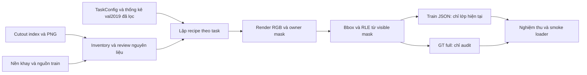

# Thiết kế đề xuất: dữ liệu ảnh ghép v2

Ngày lập: 20/10/2026. Nhánh: `feat/synthetic-data-v2`, base đọc code `9aa1b6e`. **Trạng thái: đề xuất để nhóm duyệt; chưa triển khai generator, chưa sinh dữ liệu, chưa train.**

**Cập nhật 21/10:** người dùng đặt tên bộ cũ là synthetic **v1**, xác nhận backup Drive và cho phép xóa local. `data/archive/synth/group/` đã xóa; [receipt và ảnh hưởng](../data_preprocessing/reports/synth-v1-retirement-2026-10-21.md). Bộ mới là **v2**. Các nhận xét “giữ nguồn” trong thiết kế áp dụng nguyên liệu/real release và artifacts còn lại, có ngoại lệ lưu trữ v1 đã được người dùng chỉ định này.

**Quyết định 21/10:** [quyết định v2](synthetic-data-v2-decisions-2026-10-21.md) là nguồn hiện hành. Các mục 3, 5, 6, 7 dưới đây đã sửa theo đó:
- val/test lấy trực tiếp từ RPC gốc, bỏ 208 ảnh nguồn nền;
- thống kê thiết kế lấy từ val2019 đã lọc;
- chỉ chạy FULL-SYN;
- 71.642 ảnh, 16 epoch;
- chọn camera theo hình dạng vật và cắt bổ sung camera 0;
- cổng dừng dùng cAcc-M2.

## 1. Mục tiêu và phạm vi

Cá cần kiểm tra nguyên liệu Hiển đã tách nền, tạo bộ ghép tự động và bàn giao dữ liệu có thể train, thay vì chỉnh tay hàng chục nghìn ảnh. Đầu ra nghiên cứu mong muốn là model học từ ảnh ghép nhưng nhận diện/đếm được trên ảnh quầy thật; chất lượng ảnh ghép chỉ được nghiệm thu sơ bộ bằng kiểm tra dữ liệu, khả năng chuyển sang ảnh thật phải đo bằng model sau đó.

[Ba tài liệu họp nguyên văn](../references/meeting-2026-10-20/README.md) là đầu vào. Đoạn chat mới nhất xác nhận An và Cá còn cần chốt cách xử lý. Giữ hai mức:

- Hướng đã rõ: train bằng ảnh ghép, val/test ảnh thật giữ nguyên; kiểm tra cutout sẵn có, ghép cảnh gần thực tế.
- Đề xuất từ handoff: sinh v2 thay bộ 20.000 ảnh cũ; không có SKU tương lai; chỉ nhãn hiện tại cho train; các tham số và FULL-SYN cần review trước thực hiện.

Lần thay đổi hiện tại chỉ đọc code/data metadata và lập kế hoạch. Phạm vi triển khai đầu tiên là **inventory → cắt bổ sung camera 0 → gallery nguyên liệu → pilot 200 ảnh/task → nghiệm thu → full release + bộ đánh giá từ RPC gốc → smoke loader**. FSA, sửa audit teacher, calibration theo nhóm và full training là các gói tiếp theo; không ghép việc xây generator với thay model thành một nghiệm thu duy nhất.

## 2. Quy tắc repo áp dụng

- [CLAUDE.md](../../CLAUDE.md): công việc nhỏ, có căn cứ, thay đổi đúng phạm vi, kiểm chứng hành vi.
- [Chỉ mục docs](../README.md): kế hoạch/quyết định ở `docs/project/`; nguồn ở `docs/references/`; báo cáo dữ liệu có ngày ở `docs/data_preprocessing/reports/`; tiến độ và chỉ mục cập nhật cùng thay đổi.
- [Hợp đồng dữ liệu](../data_preprocessing/formats.md) phải cập nhật **trước code** nếu bổ sung schema.
- [Quy tắc notebook](../../notebooks/README.md): thuật toán ở module/CLI; notebook điều phối và ghi run ID, thời gian thực với UTC offset, revision, config, seed, môi trường, checksum, kết quả/giới hạn. Giữ quy ước `Asia/Bangkok` của repo (UTC+7); không ghi timestamp chạy giả.
- Dataset mới ở `data/processed/`, receipts/gallery ở `runs/`, không đưa vào git. Không sửa nguyên liệu còn lại trong `data/archive`, release real v1, artifacts resolved 202 hay holdout đã khóa. Synthetic v1 đã xóa local theo yêu cầu 21/10; không tự restore hoặc dùng lại đường dẫn cũ cho v2.
- Không gọi reviewer API, tải model hoặc dùng GPU trong gói inventory/generator mặc định. Ngoại lệ đã chốt (D12): bước cắt bổ sung camera 0 tải `train2019` từ Kaggle và chạy lại SAM 2.1 b của `02_extract_objects.py` trên GPU local, thành một bộ cutout bổ sung có version riêng; không sửa `cutouts/sam/` hiện có.

## 3. Những gì đã đọc trực tiếp ở nhánh này

| Nguồn | Kết quả kiểm tra và ý nghĩa |
|---|---|
| `data/archive/cutouts/sam/index.json` | 7.502 record; đủ 200 SKU; 10–48/SKU; toàn bộ đường dẫn cutout tồn tại. Mỗi record có `source`, `camera`, `ann_id`, `bbox`, `size`, `file`. |
| Camera metadata | ID 0: 876; 1: 2.417; 2: 3.143; 3: 1.066. **Đã xác minh 21/10** bằng gallery cùng SKU qua 4 camera: 0 = ngang, 1 ≈ 45°, 2 = từ trên, 3 ≈ 30°. Nếu chỉ giữ camera 2, có 2 SKU dưới 5 cutout (88, 144), 30 SKU dưới 10. |
| Tư thế trên khay | Trong ảnh val2019, chai/lon **nằm ngang**, camera trên cao thấy thân và nhãn, tức giống cutout camera 0. Camera 2 của vật trụ chỉ thấy nắp. Các SKU ít cutout camera 2 chủ yếu là chai/lon/hộp đứng. Nhóm dạng trụ (drink, canned_food, alcohol, milk; 51 SKU) có camera 0 trung vị 4–5 cutout, 22 SKU dưới 5. |
| Ảnh nguồn | Toàn bộ `source` nối được với `instances_train2019.json`, nhưng thư mục ảnh `train2019/` không có local. train2019 có khoảng 67 ảnh mỗi camera mỗi SKU; cutout hiện có đã phủ đủ 322/322 mặt trước/sau. Cắt bổ sung camera 0 cần tải nguồn (quyết định D12). |
| `data/archive/scripts/02_extract_objects.py` | Có resize từng cutout theo `max_side=1000`; 893 record có cạnh lớn nhất 1000. Không mặc định pixel PNG của mọi cutout còn cùng tỷ lệ vật lý. Cấu hình đã dùng: `per_class=48`, trọng số camera `0:0.5,1:1,2:1.5,3:0.5`, SAM 2.1 b, lọc `min_iou=0.9`. |
| `data/archive/scripts/03_make_backgrounds.py` | Nền lấy từ 208 ảnh val2019 (0 ảnh test2019): trung bình lưới 24×24, inpaint ô bị che, phóng to, cộng nhiễu. Nền chỉ giữ trường sáng, không giữ chi tiết pixel. Theo D3, 208 ảnh nguồn bị loại khỏi val. |
| `tools/annotation_resolution.py` | Có compositor, owner mask, bbox/RLE, visibility và recipe; phục vụ thay thế 193 ảnh, còn phụ thuộc bố cục/box ảnh cũ và grid fallback. Không phải generator mới theo task/phân bố train. |
| Fingerprint resolution | Hash bao gồm toàn file `annotation_resolution.py`. Tránh sửa/refactor file này chỉ để dùng chung helper, vì có thể phá khả năng reuse artifacts đã nghiệm thu. |
| `tools/make_task_json.py` | `build_task_coco` ánh xạ RPC ID → label; `task_files` chọn ảnh theo lớp có trong ảnh, chưa có `generation_task`. Gộp các scene task 2 chứa lớp task 1 rồi export chung sẽ kéo ảnh task 2 về task 1. |
| `autocheckout/taskcfg.py` | Có mapping chuẩn, 200 SKU trong 5 data task, 24 slot dự phòng. Không tạo mapping mới và không ánh xạ hai lần. |
| `pdp/datasets/coco_hug.py`, `pdp/main.py` | Loader đọc `img_folder/file_name`; train/test image roots tách được. Processor resize khi load. Đầu vào mới phải giữ đúng root và native bbox. |
| `configs/exp/native/common.sh` | Baseline dùng cùng RAW_ROOT cho train/test trong script, F14 tắt. FULL-SYN cần wrapper riêng ở gói train; không đổi defaults B1/B2. |
| Tests hiện có | Có `test_annotation_resolution.py`, `test_make_task_json.py`, `test_native_checkout.py`, `test_taskcfg.py`; có thể dùng làm regression. Lần lập kế hoạch chưa chạy lại các suite này. |

Đây là kiểm tra metadata/code có mục đích, **không phải** full decode/hash lại 7.502 ảnh hay nghiệm thu chất lượng bằng mắt. Số 208 nền và lịch sử resolution lấy từ báo cáo trước; gói inventory phải đối chiếu lại catalog nền.

## 4. Lựa chọn thiết kế

| Hướng | Lợi ích | Giới hạn / quyết định |
|---|---|---|
| Chia lại nhãn 20.000 ảnh cũ | Nhanh, dùng ảnh đã có | Không xóa SKU tương lai trong pixel; không khôi phục seed/mask chủ. Không chọn cho mục tiêu handoff mới. |
| Mở rộng compositor resolution ngay trong file cũ | Có sẵn hình học và kiểm thử | Làm đổi fingerprint lịch sử; logic template/grid chưa phù hợp bố cục v2. Không chọn cách sửa trực tiếp. |
| **Generator v2 riêng, tái dùng mapping/IO và helper hình học ổn định** | Tách version, có task ownership, provenance, bảo toàn baseline | Phải bổ sung sampling/placement/QA. Đây là hướng đề xuất. |

Không cần viết lại loader hay framework train để sinh ảnh. Không dùng image generation AI cho việc ghép: ảnh sản phẩm/SKU phải được bảo toàn và hình học phải xác định được từ mask.

## 5. Luồng dữ liệu và hợp đồng đề xuất



### Layout đề xuất

```text
configs/data/synth_v2.json                       cấu hình versioned, phù hợp convention JSON hiện tại
autocheckout/synthetic.py                       catalog, thống kê, sampling, export
autocheckout/compositing.py                     render một scene và geometry
tools/synth_v2.py                               CLI inventory/pilot/generate/verify
notebooks/data_preprocessing/05_synthetic_v2.ipynb
data/processed/rpc_synth_v2_<version>/
  images/task_<t>/                              JPEG, relative paths từ dataset root
  owner_masks/task_<t>/                         PNG uint16; 0 là nền
  recipes/task_<t>/                             recipe deterministic
  annotations/task_<t>_rpc.json                 full GT canonical, category_id RPC 1..200
  tasks/synth_v2/                               5 cặp train/gt_full, model labels 0..199
  task_config.json                             copy byte-identical mapping real v1
  manifest.json                                identity, hashes, config, phiên bản
runs/data_preprocessing/synthetic_v2/<run_id>/   thời gian, QA, gallery, review và receipts
```

- Mỗi ảnh có `generation_task` bất biến. Export task t chỉ lấy ảnh `generation_task == t`, không tìm ngược mọi ảnh chứa SKU t trong union.
- Task 1: toàn bộ vật thuộc lớp 0..99 và được gắn nhãn. Task t≥2: số vật mới trong `[ceil(0,4n), floor(0,6n)]` kẹp vào `[1, n−1]`, tỉ lệ 40–60% kiểm tra trên toàn task; SKU cũ lấy đều theo từng SKU; không có label ≥ `seen_classes(t)`.
- Chọn cutout theo hình dạng: gói/hộp dẹt dùng camera 2; chai/lon/hộp trụ dùng camera 0 là chính, camera 2 (vật đứng) với tỉ lệ chốt ở M0; không dùng camera 1/3. Danh sách SKU theo hình dạng là một phần catalog đã review.
- `train` chỉ nhãn lớp task t; `gt_full` giữ mọi vật với `labeled` để audit. Hai file có cùng image IDs/file_names. Loader train không đọc `gt_full`.
- Canonical JSON dùng RPC IDs; chỉ `build_task_coco` chuyển sang model labels khi export từng task. Không truyền task JSON đã remap vào `--train-source` vốn chờ RPC IDs.
- Dataset image root là thư mục release synth mới; real evaluation root vẫn `data/archive`. Bộ đánh giá **tạo mới từ RPC gốc**, không copy từ release cũ: `instances_val2019.json` bỏ 208 ảnh nguồn nền (danh sách + checksum) và `instances_test2019.json` đầy đủ, chuyển RPC ID → nhãn model bằng `task_config.json` real v1, tách theo task, giữ `level`. Thêm tập so sánh B1/B2: 6.003 ảnh test của release cũ, dùng nguyên file đã khóa.
- `owner == instance_id` là visible mask cuối. Bbox phải bằng `mask_bbox(mask)`, `area == mask.sum()`, RLE round-trip đúng. **Không** yêu cầu IoU hình chữ nhật với silhouette ≥0.98.
- Rendering alpha và annotation mask tách rõ: owner lấy support `alpha >=128` sau transform, shadow không được tính là vật. Feather ở viền không được làm mất vật nhỏ; kiểm tra ảnh RGB song song với geometry.
- Mỗi vật lưu cutout/hash, SKU, camera/source, scale, rotation, vị trí, layer, màu/bóng, full-mask area và visible fraction; mỗi ảnh có background/hash, seed, config identity, JPEG parameters.
- Seed theo `(dataset_seed, task_id, image_index, retry_index)` bằng hàm hash ổn định, không dùng Python `hash()`. Workers không làm đổi kế hoạch sampling hay thứ tự JSON.
- Byte-identical áp dụng payload ảnh/mask/annotation/recipe trong cùng code/config/assets và phiên bản thư viện. Run timestamps/host/duration ở receipt riêng, không nhét vào payload rồi yêu cầu checksum giống giữa hai lần chạy.
- Fingerprint khác thì output version mới; không âm thầm ghi đè dữ liệu đã duyệt. Không publish một release thiếu ảnh do placement thất bại.

### Thống kê thiết kế từ val2019 đã lọc

Không còn tập train ảnh quầy thật, nên theo D5 thống kê lấy từ **val2019 đã bỏ 208 ảnh nguồn nền** (5.792 ảnh): số vật/level (easy 4–10, medium 10–15, hard 15–20), bbox area/aspect theo SKU, overlap bbox, màu/sáng, tỉ lệ vật đứng/nằm theo nhóm. Không dùng test2019. Bbox overlap là proxy, **không phải** phần trăm diện tích mask bị che; ghi rõ giới hạn này.

Không suy kích thước vật lý từ pixel PNG đã resize; dùng bbox/metadata nguồn để kiểm tra scale, rồi đối chiếu kích thước theo SKU trên val2019. 19% cutout camera 2 nhỏ hơn kích thước trung vị của SKU đó trong val (phải phóng to); sau khi thu về 640 điều này không đáng kể, nhưng phải ghi lại.

Số ảnh full: `[21752, 12534, 12129, 11850, 13377]`, tổng **71.642 ảnh**, bằng số ảnh mỗi task của B2; train 16 epoch/task nên số bước bằng B2 (D9). Ảnh ghép task 1 có khoảng 12 vật có nhãn/ảnh (ảnh thật: 6,4), task 2–5 khoảng 6 vật mới/ảnh (ảnh thật: 2,7–2,9), nên supervision mỗi SKU gấp khoảng 2 lần B2. Phải báo cáo cả vật mới/cũ và ngân sách FSA bổ sung.

## 6. Những điều phải chốt bằng evidence và review

| Điểm | Đề xuất ban đầu | Cách khép |
|---|---|---|
| Camera → góc và tư thế | **Đã chốt (D11):** 0 ngang, 1 ≈ 45°, 2 trên, 3 ≈ 30°; gói/hộp dẹt dùng camera 2, vật trụ dùng camera 0 là chính; bỏ camera 1/3 | Gallery M0 chốt danh sách SKU theo hình dạng và tỉ lệ vật đứng/nằm đo trên val2019. |
| ≥5 cutout/SKU | Ngưỡng nghiệm thu nguyên liệu, tính **theo góc được dùng** của SKU | Cắt bổ sung camera 0 cho nhóm dạng trụ từ train2019 (D12). Nếu chưa tải được nguồn, báo SKU thiếu cụ thể; không tự lấy mask bị loại. |
| Vật mới 40–60%, visible ≥70% | Tham số pilot, chưa là tối ưu | Số vật mới kẹp vào `[1, n−1]`, tỉ lệ kiểm tra trên toàn task (D13). Visible ≥70% review ở gallery pilot. |
| Không flip, rotate toàn vòng | Theo handoff | Unit test không phản chiếu chữ; visual review hình dáng và nhãn. |
| Cân bằng SKU ±20% | Theo handoff | Tính quota trước render, kiểm tra feasibility và counts sau render. Không bù bằng việc lặp cùng ảnh. |
| Phân bố scale/overlap | Fit trên val2019 đã lọc, không tự đoán | Báo cáo phân bố riêng từng SKU/camera; chốt config sau pilot. |
| Giống ảnh thật | Gallery tối thiểu 100 ảnh, phủ 5 task/3 level, xem thêm nhóm lỗi | Nhóm ghi reviewer, quyết định, lý do và config hash. Metrics hình ảnh không thay visual QA. Sau đó cổng dừng task 1 đo khả năng chuyển sang ảnh thật. |
| Dùng real statistics | Lấy từ val2019 đã lọc (D5) | Ghi “train bằng ảnh ghép; phân bố bố cục ước lượng từ val2019”, không quảng bá hoàn toàn không dùng dữ liệu thật. |
| Chỉnh lại sau val | Tối đa 3 vòng, nút đăng ký trước (D4, D20) | Mỗi vòng sinh version mới, ghi thay đổi/config hash/kết quả val; không đổi số ảnh. |
| DINO/CLIP, CycleGAN, trộn real | Chưa làm ở v2 đầu tiên | Gói/thí nghiệm riêng nếu nhóm quyết định; không tự tải model hay trộn dữ liệu. |

## 7. Điều kiện chuyển sang train

Generator không giải quyết tự động teacher tự tin nhưng sai, prototype drift hoặc thiếu recall nhãn giả. I3/F14 là biện pháp dự kiến, cần audit trên đúng preprocessing.

Gói train sau data cần: export/load FSA ConvNeXt round-trip giữ backbone/config; audit teacher dùng processor checkpoint và full GT để phân loại nhầm mới→cũ; lưu policy threshold theo nhóm chọn trên val; log theo handoff; thử task 1 trước task 2–5.

**Cổng dừng sau task 1 (D16–D19):** đo cAcc-M2 trên 5.562 ảnh val2019 đã lọc có SKU task 1, bỏ dự đoán trùng (IoU ≥ 0,5) với vật SKU chưa học. So với B2 tính lại cùng cách từ `pred_val.npz`: Δ ≥ −13 chạy tiếp; −28 ≤ Δ < −13 chỉnh một vòng; Δ < −28 chỉnh một vòng, hết 3 vòng thì dừng. Model FSA < 40% thì bỏ PDP task 1 của vòng đó. Val được dùng lặp có chủ đích (cách 2), không gọi là holdout chưa dùng; test2019 chỉ chấm một lần ở cấu hình cuối. Lý do và giới hạn ở [quyết định v2](synthetic-data-v2-decisions-2026-10-21.md#4-cổng-dừng-sau-task-1).

FULL-SYN thay nhiều yếu tố và có FSA thêm compute; dùng để đo cả cấu hình tổng hợp, không quy hiệu quả riêng cho ảnh ghép. FULL-REAL **hoãn** (D6); nếu chạy sau thì train trên split thật cũ và chấm trên 6.003 ảnh test cũ.

## 8. Bàn giao

Mốc đầu tiên để Cá/An/Hiển xem: inventory đủ/thiếu, gallery camera/mask, cutout camera 0 bổ sung, thống kê val2019 đã lọc và đề xuất config. Mốc thứ hai: 1.000 ảnh pilot, train/gt_full, gallery và nghiệm thu. Chỉ sau review pilot mới sinh full.

Phân công đề xuất: Cá điều phối pipeline và evidence; Hiển hỗ trợ nguồn cutout/giải thích extraction; An cùng Cá chốt protocol/chất lượng. Đây không phải xác nhận phân công của nhóm.

[Kế hoạch từng bước](synthetic-data-v2-plan-2026-10-20.md).
